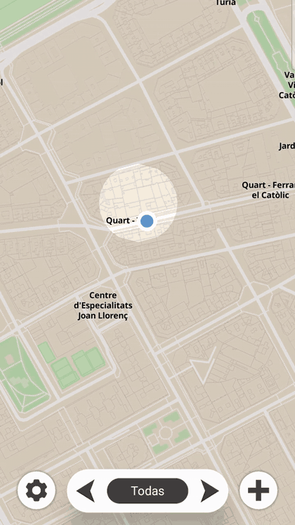

# Atlas

**Urban exploration app for Android**: it records the places you visit, reveals the map through a *fog of war* system, and lets you create and organize your own points of interest.

Developed as my Bachelor's Thesis in Computer Engineering (Universitat Politècnica de València, 2025–2026). Grade: 9/10.

Screenshots of the main features:

  

### Different styles
The app lets you choose between different visual styles to customize the result.

  

### Final result
An example of the result after configuring different styles and icons.

  

**[Download APK](../../releases/latest)**

---

## Features

- **Fog of war**: the map starts covered and is revealed as you visit new areas, even while the app runs in the background.
- **Custom points of interest**: markers with configurable color and icon, description, 0–5 star rating, goal checklist and visit counter.
- **Templates**: define a marker type once and apply it to others. Only the fields filled in the template are overwritten.
- **Layers**: organize markers into layers and display one or all of them.
- **Gallery import**: photos with location data (EXIF) are automatically turned into markers, incrementally.
- **Weather information** for the location, shown directly in the interface.

## Tech stack

| | |
|---|---|
| Language | Kotlin |
| UI | Jetpack Compose |
| Maps | MapLibre (migrated from Mapbox) |
| Persistence | Room |
| Location | Fused Location Provider · Activity Recognition API |

## Technical highlights

### Background tracking and battery usage
Design decisions to optimize tracking:
- GPS request frequency adapts to the detected type of movement (walking, running, cycling, in a vehicle), and tracking does not start while the device is still.
- In the background, **raw GPS points** are stored instead of computing cells on the fly. When the app is opened, **gaps between points are interpolated** to obtain the visited cells. This allows a lower sampling rate without losing accuracy in the revealed map.
- Users can choose between three accuracy/battery levels: **Saver**, **Balanced** and **High**.

### Migration from Mapbox to MapLibre
The first version used the Mapbox SDK, which charges per use. So that the app could be published without depending on that cost, I migrated the map engine to **MapLibre**, an open-source fork, and recreated the map styles.

### Persistence
All data (markers, templates, layers, visited cells, route points and settings) is stored with **Room**, replacing an earlier version based on DataStore + Gson.

## Next steps

- Local database encryption.
- Backup export and import.
- Percentage explored of each city or country.

## Author

**Sergio García Serrano** · [LinkedIn](https://www.linkedin.com/in/sergio-garc%C3%ADa-serrano-550925233/) · [Email](mailto:sergiogarciaserrano61@gmail.com)
