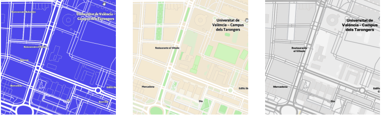
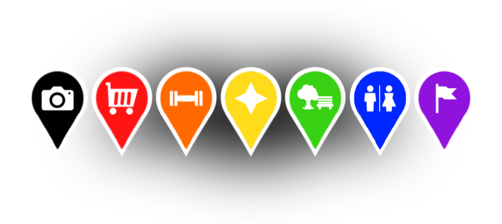

# Atlas

**App Android de exploración urbana**: registra los lugares por los que pasas, revela el mapa con un sistema de *fog of war* y te permite crear y organizar tus propios puntos de interés.

Proyecto desarrollado como Trabajo Fin de Grado en Ingeniería Informática (UPV, 2025–2026). Calificación: 9.


<p align="center">
  
  
</p>

📥 **[Descargar APK](../../releases/latest)**

---

## Funcionalidades

- **Fog of war**: el mapa empieza cubierto y se va revelando según las zonas que visitas, también con la app en segundo plano.
- **Puntos de interés personalizados**: marcadores con color e icono configurables, descripción, valoración de 0 a 5 estrellas, checklist de objetivos y contador de visitas.
- **Plantillas**: define un tipo de marcador una vez y aplícalo a otros. Solo se sobrescriben los campos que la plantilla tiene rellenos.
- **Capas**: organiza los marcadores en capas y muestra una o todas.
- **Importación desde la galería**: las fotos con ubicación (EXIF) se convierten automáticamente en marcadores, de forma incremental.
- **Información meteorológica** del lugar en la propia interfaz.

## Tecnologías

| | |
|---|---|
| Lenguaje | Kotlin |
| UI | Jetpack Compose |
| Mapas | MapLibre (migrado desde Mapbox) |
| Persistencia | Room |
| Ubicación | Fused Location Provider · Activity Recognition API |

## Detalles técnicos destacados

### Seguimiento en segundo plano y consumo de batería
Decisiones de diseño para el optimización de seguimiento:
- La frecuencia de peticiones GPS se adapta al tipo de movimiento detectado (andar, correr, bici, vehículo), y el seguimiento no se activa si el dispositivo está quieto.
- En segundo plano se guardan **puntos GPS en bruto** en vez de calcular celdas al vuelo. Al abrir la app, se **interpolan los huecos** entre puntos para obtener las celdas visitadas. Esto permite bajar la frecuencia de muestreo sin perder fidelidad en el mapa revelado.
- El usuario puede elegir entre tres niveles de precisión/consumo: **Ahorro**, **Equilibrado** y **Alta**.

### Migración de Mapbox a MapLibre
La primera versión usaba el SDK de Mapbox, que factura por uso. Para que la app pudiera publicarse sin depender de ese coste, migré el motor cartográfico a **MapLibre**, un fork de código abierto, y recreé los estilos del mapa.

### Persistencia
Todos los datos (marcadores, plantillas, capas, celdas visitadas, puntos de ruta y ajustes) se guardan en **Room**. Esta versión sustituye a una anterior basada en DataStore + Gson.

## Cómo ejecutarlo

1. Clona el repositorio:
   ```bash
   git clone https://github.com/<tu-usuario>/atlas.git
   ```
2. Ábrelo con Android Studio.
3. Ejecútalo en un dispositivo o emulador con Android, con SDK mínimo de 24.

La app pide los permisos de ubicación (incluida la ubicación en segundo plano), de reconocimiento de actividad y, si activas la importación, de acceso a fotos.

## Próximos pasos

- Cifrado de la base de datos local.
- Exportación e importación de copias de seguridad.
- Porcentaje explorado de cada ciudad o país.

## Autor

**Sergio García Serrano** · [LinkedIn](https://www.linkedin.com/in/sergio-garc%C3%ADa-serrano-550925233/) · [Email](mailto:sergiogarciaserrano61@gmail.com)
